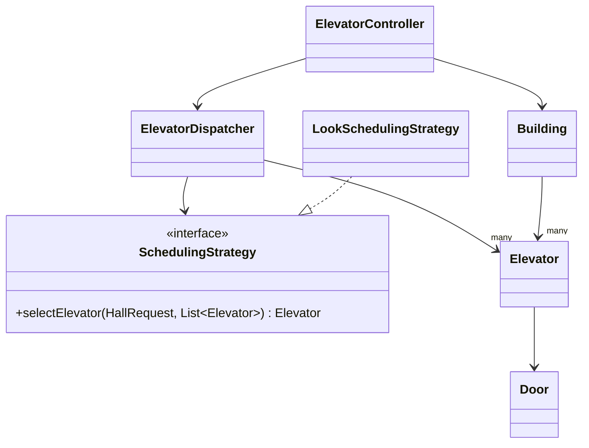
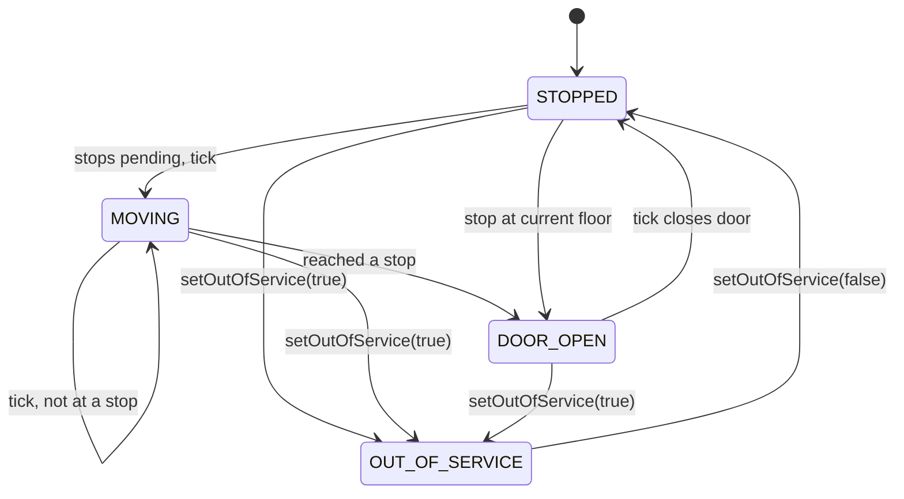

# Elevator System — Low-Level Design Deep Dive

## 1. Requirements

- A building with floors `[min, max]` and several elevators.
- Passengers press a **hall button** (floor + UP/DOWN) and, once inside, a **car button** (destination).
- The system picks which elevator answers a hall call and serves stops efficiently.
- Elevators can be taken out of service and restored.
- Concurrent callers must not corrupt elevator state or double-book a stale view.

Out of scope: capacity/weight, door timers, real-time physics, hardware safety interlocks.

## 2. Key terms

| Term | Meaning | Where it appears |
|------|---------|------------------|
| **Hall request** (outer request) | Button pressed on a floor, outside the elevator. Carries the caller's floor and the direction they want to travel. The system must **choose** which elevator answers it. | `HallRequest(floor, direction)`, `controller.requestElevator(3, UP)` |
| **Car request** (inner request) | Destination button pressed inside a specific elevator. Carries the elevator id and the destination floor. No scheduling is needed; the car is already known. | `CarRequest(elevatorId, destinationFloor)`, `controller.selectFloor(1, 8)` |
| **Stop** | A floor an elevator has promised to visit. Each elevator keeps its stops in four lists (see section 6). | `Elevator` fields |
| **Tick** | One unit of simulated time. Each tick advances every elevator by at most one step. | `controller.tick()` → `Elevator.step()` |
| **Snapshot** | A frozen, immutable copy of an elevator's state, taken under its lock. | `ElevatorSnapshot` |

`controller.requestElevator(3, UP)` reads as: "I am standing on floor **3** and want to go **UP**." It does not mean "send an elevator to go up to floor 3".

## 3. Class overview

Floors are plain `int` values; there is no `Floor` class. `Building` holds the valid range and validates against it.

| Class | Init args | Responsibility |
|-------|-----------|----------------|
| `Elevator` | `id, initialFloor, minFloor, maxFloor` | One car. Owns position, direction, state, door and four stop sets. All mutation happens under its own lock. |
| `Door` | none (starts `CLOSED`) | Open/closed state. Package-private and protected by the elevator's lock. |
| `Building` | `minFloor, maxFloor, List<Elevator>` | A building has floors **and** elevators, so it takes both. Validates floors, unique ids and that each elevator's range matches. |
| `SchedulingStrategy` | none (interface) | Port: `selectElevator(HallRequest, List<Elevator>)`. |
| `LookSchedulingStrategy` | none | Cost-based heuristic over `ElevatorSnapshot`s. |
| `ElevatorDispatcher` | `List<Elevator>, SchedulingStrategy` | Picks an elevator through the strategy and assigns the hall call as one atomic step. Forwards car calls, ticks, status and out-of-service changes. |
| `ElevatorController` | `Building, ElevatorDispatcher` | Public entry point. Validates floors against the `Building`, then delegates to the dispatcher. |
| `HallRequest`, `CarRequest`, `ElevatorSnapshot` | record fields | Immutable data carriers. |

The scheduling algorithm is injected into the dispatcher so it can be swapped without touching anything else.

**Why a controller *and* a dispatcher?** They could be merged into one class (for example `ElevatorRequestHandler.request(floor, direction)`) that validates the floor and dispatches. They are split for the Single Responsibility Principle:

- The **controller** is the API boundary: it knows about the `Building` and validates input.
- The **dispatcher** is the engine: it knows about elevators and the strategy, and owns the assignment lock.

Merging is a legitimate simplification for a small system; the split mainly buys a cleaner place to change either side independently.



## 4. Request flow walkthrough

### 4.1 How the program starts (`ElevatorDemo`)

1. Create the elevators: `new Elevator(id, startFloor, min, max)`. The constructor rejects `min > max` and a start floor outside the range.
2. Create `new Building(0, 10, elevators)`. It rejects an empty list, duplicate ids and elevators whose floor range differs from the building's.
3. Create `new ElevatorDispatcher(building.elevators(), new LookSchedulingStrategy())`.
4. Create `new ElevatorController(building, dispatcher)`. This is the only object callers use.
5. Send requests, then call `controller.tick()` repeatedly to advance time.

### 4.2 Hall request: `controller.requestElevator(3, UP)`

```text
ElevatorController.requestElevator(floor, direction)
  ├─ building.validateFloor(floor)              → IllegalArgumentException if outside range
  ├─ new HallRequest(floor, direction)          → NPE if null, IllegalArgumentException if IDLE
  └─ ElevatorDispatcher.dispatch(request)       [takes assignmentLock]
       ├─ strategy.selectElevator(...)          scores a snapshot of each in-service elevator
       │                                        → IllegalStateException if none available
       └─ elevator.acceptHallRequest(request)   [takes that elevator's lock]
            ├─ out of service        → returns false → dispatcher throws IllegalStateException
            ├─ validate floor again
            ├─ already on that floor and idle/same direction → open door, done
            └─ otherwise add to hallUpStops / hallDownStops;
               if the car was IDLE, choose a direction
       returns the assigned elevator id
```

**Why the dispatcher takes a lock.** Selecting the best elevator and assigning the request are two operations that must behave as one transaction. Without the lock, two callers could both look at the same idle elevator, both choose it, and both assume they got the best car from an up-to-date view. The lock serializes select + assign.

### 4.3 Car request: `controller.selectFloor(elevatorId, 8)`

1. `building.validateFloor(8)`.
2. The dispatcher finds the elevator by id (`IllegalArgumentException` if unknown).
3. `elevator.acceptCarRequest(...)`:
   - out of service → `false` → `IllegalStateException`;
   - destination equals the current floor → open the door;
   - destination above the car → `upCarStops`, below → `downCarStops`;
   - if the car was IDLE, choose a direction.

### 4.4 Time passing: `controller.tick()`

The controller calls `dispatcher.tickAll()`, which calls `step()` on every elevator once. The algorithm is in section 7.

### 4.5 Worked example from the demo

Elevators start at floors 0, 5 and 10. `requestElevator(3, UP)`, then `selectFloor(2, 8)`:

| Tick | Elevator 2 | What happened |
|------|-----------|---------------|
| request | floor 5, idle | Scored lowest, so it is assigned the floor-3 pickup. |
| 1 | floor 4, DOWN, MOVING | Heads toward the nearest stop (3). The car stop at 8 is also pending. |
| 2 | floor 3, UP, DOOR_OPEN | Picks up the caller and adopts the caller's direction (UP). |
| 3–6 | floors 4 → 7, MOVING | Travels up toward 8. |
| 7 | floor 8, IDLE, DOOR_OPEN | Drops off; no stops left. |
| 8+ | floor 8, IDLE, STOPPED | Nothing to do. |

## 5. Elevator state



`Direction` (UP / DOWN / IDLE) is tracked separately from `ElevatorState`: a car can be `STOPPED` with direction `UP` (about to continue) or `DOOR_OPEN` while still committed to a direction.

## 6. Stop model

Each elevator keeps four sorted sets rather than one. The first two columns use the names in the code; "outer" and "inner" are the informal names for hall and car stops.

| Set | Informal name | Meaning | Order |
|-----|---------------|---------|-------|
| `hallUpStops` | outer up | Hall calls wanting to go UP | ascending |
| `hallDownStops` | outer down | Hall calls wanting to go DOWN | descending |
| `upCarStops` | inner up | Passenger destinations above the car | ascending |
| `downCarStops` | inner down | Passenger destinations below the car | descending |

**Why four sets?** A hall call has a direction and a car call doesn't, and the two must be kept apart. A rider on floor 6 who pressed DOWN must be picked up as a DOWN passenger, even if the car arrives from below. A single set of floors can't express that.

**Why do the DOWN sets use `Comparator.reverseOrder()`?** When the car travels down, the next stop is the *highest* floor below it (10 → 7 → 4 → 1). A descending `TreeSet` keeps stops in the order they will be visited, so the nearest stop in the direction of travel comes first. UP sets are naturally ascending. It is not tied to the car starting at the top floor; it follows from how a downward sweep visits floors.

> **Implementation note:** the current `step()` decides whether to stop by checking `contains(currentFloor)` on each set, and finds nearest floors with streams. So the ordering documents the intended sweep order and would let a future version simply peek at `first()`, but the present logic doesn't depend on it. Each set is a `Set`, so pressing the same floor twice adds it once.

**Serving a stop.** Car destinations are served regardless of travel direction. Hall pickups keep their requested direction: after serving one, the car adopts it, so a rider who pressed DOWN isn't carried upward.

## 7. `step()` algorithm (one tick)

1. Out of service → report `OUT_OF_SERVICE`, do nothing.
2. Door open → close it, state `STOPPED`.
3. No stops → direction `IDLE`, return.
4. Direction `IDLE` → choose a direction.
5. Stop at the current floor → serve it (open door, adopt hall direction) and return. No movement this tick.
6. Nothing ahead in the current direction → reverse.
7. Move one floor (floor bounds are enforced; at a bound, flip and re-choose).
8. If the new floor is a stop → serve it.
9. Assert invariants (in bounds; no movement with door open).

Direction choice when stops exist both above and below: nearest stop wins, ties go UP.

**At every floor** the car checks all four sets for the floor it is on (steps 5 and 8). If the floor is in any of them, it removes it from those sets, opens the door and enters `DOOR_OPEN`. If not, it keeps going.

**Direction rule.** The car keeps its direction while any stop remains ahead and reverses only when none do. When no stops remain at all it becomes `IDLE` and `STOPPED`.

## 8. Scheduling

`LookSchedulingStrategy` scores every in-service elevator from a snapshot (lowest wins):

```
score = 10 * |elevatorFloor - callFloor|
      - 5                          if IDLE
      + 100                        if moving the opposite way to the call
      + 60                         if moving the same way but already past the caller
      + 4 * pendingStops
```

Ties go to the first elevator in the list. It's a baseline heuristic with no optimality claim. Swap in another strategy (zoning, destination dispatch) via `SchedulingStrategy` without touching the dispatcher.

## 9. Concurrency

| Concern | Decision |
|---------|----------|
| Per-elevator state | Every public `Elevator` method takes that elevator's `ReentrantLock`; `*Unsafe` helpers are only called under it. |
| Consistent reads | The scheduler only sees `ElevatorSnapshot`s, each taken atomically under the elevator lock. A snapshot reads floor, direction, state and stop count in one locked moment, so they always agree. |
| Selection + assignment | `ElevatorDispatcher.dispatch` holds `assignmentLock` across select and accept, so two callers can't both choose from the same stale idle view. |
| Ticking | `tickAll` doesn't take the dispatch lock. Each elevator moves independently under its own lock. |
| Lock ordering | Dispatcher lock → one elevator lock (never the reverse), so there is no cycle. |

**The lock is not held while an elevator "moves".** `step()` only updates fields (for example `currentFloor++`) and releases the lock within microseconds. A trip across ten floors is ten separate `step()` calls with the lock free in between. So hall and car requests are accepted whether the car is idle, moving or has its door open; only an out-of-service car rejects them. `IDLE` affects *scheduling* (idle cars get a score bonus), not whether a request is accepted.

**Snapshots can go stale.** A snapshot may be outdated by the time the elevator is assigned (a tick or an out-of-service change can interleave). The strategy only scores from it. `acceptHallRequest` re-checks the out-of-service flag under the elevator lock and returns `false`, and the dispatcher turns that into an `IllegalStateException` instead of silently dropping the call.

## 10. Error handling and edge cases

| Situation | Result |
|-----------|--------|
| Floor outside the building | `IllegalArgumentException` |
| Hall request with `IDLE` direction | `IllegalArgumentException` |
| Hall request with `null` direction | `NullPointerException` |
| Unknown elevator id | `IllegalArgumentException` |
| Duplicate ids / mismatched floor ranges / no elevators | `IllegalArgumentException` at `Building` construction |
| Car call to an out-of-service elevator | `IllegalStateException` |
| Hall call with every elevator out of service | `IllegalStateException` ("No available elevators") |
| Request for the floor the car is already on | Door opens immediately (car call: always; hall call: if the car is idle or heading the same way, otherwise it is stored as a normal stop) |
| Same floor requested twice | Stored once (the stop lists are sets) |
| Car reaches the top or bottom floor | Never leaves `[min, max]`; direction flips |
| Elevator taken out of service | Skipped by the scheduler, door closes, pending stops are dropped |
| Door open | The car does not move; it closes the door first and never moves in the same tick that it opens it |

## 11. Design decisions and trade-offs

- **Strategy interface for scheduling** — the dispatcher stays unchanged when the algorithm changes.
- **Controller and dispatcher split** — the controller is the validating API boundary and the dispatcher is the assignment engine. They could be merged in a small system; the split keeps each class to one job.
- **Snapshots, not live elevators, for scoring** — avoids holding several elevator locks and keeps the strategy pure.
- **Per-elevator lock, not one global lock** — elevators are independent, so ticking doesn't serialize.
- **Four stop sets** — lets hall pickups keep their direction, which a single set of floors can't express.
- **Out-of-service drops stops** — those stops were promised by that car. Keeping them would strand passengers silently, and the dropped hall calls must be re-requested.
- **Discrete ticks** — the simulation is deterministic and testable, but it doesn't model real time.

## 12. Time and the clock

Today nothing waits: the caller decides when time passes by calling `controller.tick()`, which the demo does in a loop. The door stays open for exactly one tick, and a car moves one floor per tick.

To drive it from a real timer, call `tick()` from a scheduler, for example `scheduleAtFixedRate(controller::tick, 0, 1, SECONDS)`. Two rules apply:

- **Never sleep or wait inside `step()`.** That would hold the elevator lock and block requests, snapshots and scheduling for that car. `step()` should only record state and return; the waiting belongs to the timer.
- **Model slow things as counters.** If floor-to-floor travel takes 5 seconds, make it 5 ticks with a per-car travel counter. If doors should stay open 3 seconds, add a door-hold counter. Both fit the 1-second tick without blocking.

Where the timer lives is a design choice:

| Option | Description | Trade-off |
|--------|-------------|-----------|
| **External clock** (current) | The dispatcher's `tickAll()` is called by one timer. | Simple and deterministic; tests call `step()` directly. |
| **Per-elevator clock** | Each elevator schedules its own next step: after moving, it checks its stop sets, waits, and moves again, or stops if none remain. A newly added stop wakes it (or a 1-second timer re-checks). | More realistic, with independent timing per car; needs thread lifecycle, `Condition` wake-ups and non-deterministic tests. |

A good middle path is to keep `step()` as the deterministic core and let each elevator own its schedule on a shared `ScheduledExecutorService`.

## 13. Possible extensions

- Reassign dropped hall calls to other elevators when one goes out of service.
- Capacity limits and an overload state.
- Destination-dispatch or zoned strategies.
- A real clock with door-hold timers and a scheduled executor driving `tick()`.
- An event/observer hook for logging and UI display.
