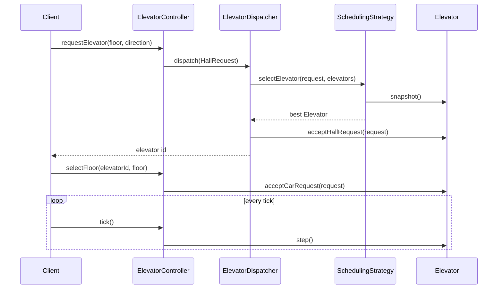

# Elevator System (Java)

**Author:** [vinu-varsidh](https://github.com/vinu-varsidh) — design and implementation.

A small, thread-aware simulation of a multi-elevator building: hall calls are dispatched to the best elevator, each car serves its stops LOOK-style (keep going while there is something ahead, then reverse), and every car guards its own state with a lock.

> Educational simulation, not certified elevator-control software. Real elevators require independent hardware safety systems.

**Requirements:** Java 17+ (records, `List.copyOf`, `Stream.toList`).

> **New to the design?** Read [LLD/DEEP_DIVE.md](LLD/DEEP_DIVE.md) for the walkthrough, per-class decisions and invariants.

## Quick start

With Maven:

```bash
mvn compile exec:java
```

Without Maven:

```bash
mkdir -p target/classes
find src/main/java -name '*.java' | xargs javac --release 17 -d target/classes
java -cp target/classes com.elevator.ElevatorDemo
java -cp target/classes com.elevator.ElevatorVerification
```

Expected demo output (first ticks): elevator 2 is chosen for a floor-3 UP call, picks up, then drops off at floor 8.

```
Hall request at floor 3 UP assigned to elevator 2
Tick 1: E1@0 IDLE/STOPPED pending=0 | E2@4 DOWN/MOVING pending=2 | E3@10 IDLE/STOPPED pending=0
Tick 2: E1@0 IDLE/STOPPED pending=0 | E2@3 UP/DOOR_OPEN pending=1 | E3@10 IDLE/STOPPED pending=0
...
Tick 7: E1@0 IDLE/STOPPED pending=0 | E2@8 IDLE/DOOR_OPEN pending=0 | E3@10 IDLE/STOPPED pending=0
```

`ElevatorVerification` is a dependency-free harness (34 checks: validation, scheduling, door safety, direction handling, out-of-service, concurrent callers). It exits non-zero on failure.

## Project layout

| Path | Role |
|------|------|
| `src/main/java/com/elevator/enums/` | `Direction`, `ElevatorState`, `DoorState` |
| `src/main/java/com/elevator/model/` | Immutable records: `HallRequest`, `CarRequest`, `ElevatorSnapshot` |
| `src/main/java/com/elevator/elevator/` | `Elevator` (stop sets, movement, locking) and package-private `Door` |
| `src/main/java/com/elevator/building/` | `Building` — floor range, elevator list, configuration checks |
| `src/main/java/com/elevator/strategy/` | `SchedulingStrategy` port and `LookSchedulingStrategy` |
| `src/main/java/com/elevator/service/` | `ElevatorDispatcher` (assignment) and `ElevatorController` (public API) |
| `src/main/java/com/elevator/ElevatorDemo.java` | End-to-end runnable example |
| `src/main/java/com/elevator/ElevatorVerification.java` | Runnable checks |

## High-level flow



## Behavior summary

- **Hall call** (`requestElevator`): validated against the building, scored per elevator, assigned atomically. Returns the chosen elevator id.
- **Car call** (`selectFloor`): added to that elevator's up/down destination set.
- **Tick**: each elevator closes an open door, then either serves a stop on its current floor or moves one floor. A car never moves in the same tick it opens its doors.
- **Direction**: kept while stops remain ahead; reversed only when nothing is left ahead. Serving a hall pickup adopts the caller's requested direction.
- **Out of service**: skipped by the scheduler, rejects car calls, and drops its pending stops so they aren't silently resumed later.

## Known simplifications

- Time is a discrete `tick()`, with no real clock, door timers or acceleration.
- Hall calls are assigned once; they are not reassigned if the chosen car later goes out of service (its stops are dropped).
- No capacity, weight or overload modelling.
- The scheduler is a baseline heuristic, not an optimal one.
